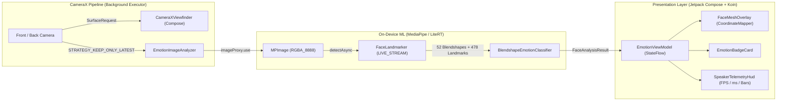

# Selfie: Real-Time Emotion Detector with CameraX

An open-source, production-ready Android application that detects facial expressions and classifies emotions in real time using **Jetpack CameraX (`camera-compose`)** and **MediaPipe Face Landmarker (`tasks-vision` / LiteRT)** on **Jetpack Compose**.

All processing runs **100% on-device**—no frames or biometric data ever leave the device.

---

## Architecture Overview



---

## Features

- **Lifecycle-Safe Camera Stream**: Uses `androidx.camera:camera-compose` with `CameraXViewfinder` and `SurfaceRequest`, bound to the lifecycle via `ProcessCameraProvider`.
- **On-Device Emotion Classification**: Converts 52 ARKit-compatible facial blendshapes (FACS Action Units) into discrete emotion states (**Happy**, **Surprised**, **Angry**, **Sad**, **Disgusted**, **Wink**, and **Neutral**).
- **Temporal Smoothing (EMA)**: Applies Exponential Moving Average (`alpha = 0.38`) to raw blendshape outputs to eliminate UI flicker.
- **Accurate Screen Transforms**: Projects normalized `[0..1]` landmarks to screen coordinates while accounting for `FILL_CENTER` (Center-Crop) aspect ratios and front-camera horizontal mirroring.
- **Real-Time 478-Point Face Mesh**: Dynamic Compose `Canvas` overlay that draws contours for eyes, eyebrows, lips, face oval, and iris centers, tinted to the active emotion color.
- **Buffer Hygiene & Non-Blocking Pipeline**:
  - `ImageAnalysis.STRATEGY_KEEP_ONLY_LATEST` prevents frame queues and latency buildup.
  - Kotlin `imageProxy.use { ... }` ensures `close()` is always called, preventing camera pipeline starvation.
  - `ImageAnalysis.OUTPUT_IMAGE_FORMAT_RGBA_8888` eliminates manual YUV-to-RGB conversion loops.
  - Pre-allocated bitmap buffer reuse eliminates garbage collection stutter.
- **Interactive Telemetry HUD**: Live metrics showing instantaneous FPS, inference latency in milliseconds, frame resolution, active delegate (CPU/GPU), and real-time activation bars for the top 6 facial blendshapes.

---

## Tech Stack & Libraries

| Category | Technology / Library | Version | Purpose |
|---|---|---|---|
| **Language** | Kotlin | 2.2.10 | Core programming language |
| **UI Toolkit** | Jetpack Compose + Material 3 | BOM 2026.02.01 | Declarative UI, edge-to-edge layout, animations |
| **Camera** | Jetpack CameraX | 1.5.0-alpha06 | `camera-core`, `camera-camera2`, `camera-lifecycle`, `camera-compose` |
| **Machine Learning** | MediaPipe Tasks Vision | 0.10.21 | `FaceLandmarker` with LiteRT runtime (float16 bundle) |
| **Dependency Injection** | Koin | 4.0.2 | `koin-android`, `koin-androidx-compose` |
| **Async / Coroutines** | Kotlinx Coroutines + Guava | 1.10.1 | `ListenableFuture` bridge for CameraX provider |
| **Architecture** | MVVM + Unidirectional Data Flow | — | `StateFlow` + `collectAsStateWithLifecycle()` |

---

## Project Requirements & Prerequisites

- **Android Studio**: Android Studio Ladybug (2024.2+) or newer.
- **JDK**: Java 11+ (Java 17 recommended).
- **Android SDK**:
  - `compileSdk`: 37
  - `minSdk`: 24 (Android 7.0 Nougat)
  - `targetSdk`: 37
- **Hardware / Device**:
  - **Physical Device** (Recommended): Any Android phone running Android 7.0 (API 24) or higher with a front-facing camera.
  - **Android Emulator**: Supported with API 28+. Ensure the emulator's camera is configured:
    - *Settings ➔ Camera ➔ Front Camera ➔ Set to "VirtualScene" or "Webcam0"*.
- **Runtime Permissions**: `android.permission.CAMERA` (handled via Compose in-app permission gate).

---

## Getting Started

### 1. Clone the Repository

```bash
git clone https://github.com/jacqui/Selfie.git
cd Selfie
```

### 2. Verify the Bundled Model Asset

The app bundles Google's official MediaPipe float16 `face_landmarker.task` model inside `app/src/main/assets/`.
If you need to re-download the model at any point, run:

```bash
mkdir -p app/src/main/assets
curl -L -o app/src/main/assets/face_landmarker.task \
  "https://storage.googleapis.com/mediapipe-models/face_landmarker/face_landmarker/float16/1/face_landmarker.task"
```

### 3. Build & Run from Android Studio

1. Open Android Studio and select **Open** ➔ choose the `Selfie` root directory.
2. Allow Gradle sync to complete.
3. Select your connected physical device or emulator.
4. Click **Run** (`Shift + F10`) or select the **app** configuration.
5. On the first launch, tap **Grant Camera Permission** on the rationale card.

### 4. Build from the Command Line

- **Assemble the Debug APK**:
  ```bash
  ./gradlew assembleDebug
  ```
  The generated APK will be at `app/build/outputs/apk/debug/app-debug.apk`.

- **Install to Connected Device**:
  ```bash
  ./gradlew installDebug
  ```

- **Run JVM Unit Tests**:
  ```bash
  ./gradlew testDebugUnitTest
  ```

---

## Project Structure

```text
com.jacqui.selfie
├── SelfieApplication.kt              # Application class initializing Koin DI
├── MainActivity.kt                   # Edge-to-edge host activity
├── di/
│   └── AppModule.kt                  # Koin module (Classifier, Analyzer, SessionManager, ViewModel)
├── domain/
│   ├── model/
│   │   ├── Emotion.kt                # Discrete emotions, emojis, FACS descriptions, and color tokens
│   │   └── FaceAnalysisResult.kt     # Immutable frame analysis and telemetry snapshot
│   └── classifier/
│       └── BlendshapeEmotionClassifier.kt # Pure Kotlin FACS blendshape to Emotion mapping + EMA smoothing
├── data/
│   ├── analyzer/
│   │   └── EmotionImageAnalyzer.kt   # ImageAnalysis.Analyzer + MediaPipe FaceLandmarker LIVE_STREAM
│   └── camera/
│       └── CameraSessionManager.kt   # Lifecycle-safe CameraX Preview + ImageAnalysis session manager
└── ui/
    ├── mapper/
    │   └── CoordinateMapper.kt       # Normalized [0..1] to Canvas pixel coordinate projection
    ├── components/
    │   ├── EmotionBadgeCard.kt       # Expressive card showing detected emotion & confidence
    │   ├── FaceMeshOverlay.kt        # Compose Canvas drawing 478 landmarks and contours
    │   └── SpeakerTelemetryHud.kt    # Telemetry HUD (FPS, latency ms, top blendshapes, delegate toggle)
    ├── screen/
    │   └── EmotionDetectorScreen.kt  # Main screen with permission gate and CameraXViewfinder
    ├── viewmodel/
    │   ├── EmotionUiState.kt         # Immutable UI state
    │   └── EmotionViewModel.kt       # Presentation state holder
    └── theme/                        # Material 3 colors, typography, and theme
```

---

## In-App Controls & Telemetry

When running the application:

- **Face Mesh Icon (Top Bar)**: Toggle the 478-point facial landmark mesh and contour lines on/off.
- **Analytics Icon (Top Bar)**: Expand/collapse the **Telemetry HUD**:
  - **FPS**: Instantaneous camera processing frame rate.
  - **Inference**: MediaPipe on-device latency in milliseconds.
  - **Frame Resolution**: Analysis resolution (e.g. `480x640`).
  - **Delegate Toggle**: Switch between `Delegate.CPU` and `Delegate.GPU` (with automatic fallback to CPU if GPU shaders are unsupported).
  - **Live Blendshape Bars**: Real-time progress bars for the top 6 active FACS facial blendshapes (e.g., `mouthSmileLeft`, `jawOpen`, `browDownLeft`).
- **Camera Switch Icon (Top Bar)**: Toggle between the front selfie camera and rear camera.
- **Emotion Badge (Bottom)**: Displays the active dominant emotion, confidence percentage, FACS driver description, and secondary emotion distribution chips.

---

## Unit Testing

Pure domain components are isolated from the Android framework and tested on the JVM:

- **[`BlendshapeEmotionClassifierTest`](app/src/test/java/com/jacqui/selfie/domain/classifier/BlendshapeEmotionClassifierTest.kt)**: Verifies emotion classification rules for Happy, Surprised, Angry, Sad, Disgusted, Wink, Neutral, and EMA temporal jitter dampening.
- **[`CoordinateMapperTest`](app/src/test/java/com/jacqui/selfie/ui/mapper/CoordinateMapperTest.kt)**: Verifies center-point mapping invariance, front-camera horizontal mirroring (`1f - x`), and `FILL_CENTER` aspect-ratio crop offsets across different screen aspect ratios.

Run all tests with:
```bash
./gradlew testDebugUnitTest
```

---

## License

This project is open-source under the Apache License 2.0.
