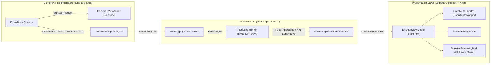

# Selfie: Building a Real-Time Emotion Detector with CameraX

A modern, production-ready Android demo application created for the session **"Building a Real-Time Emotion Detector with CameraX"**.

This project demonstrates how to stream live front/back camera frames using **Jetpack CameraX (`camera-compose`)**, run on-device machine learning inference via **MediaPipe Face Landmarker (`tasks-vision` / LiteRT)**, classify 52 ARKit-compatible facial blendshape scores into discrete emotions, and project 478 normalized 3D landmarks onto a **Jetpack Compose `Canvas`** overlay without frame drops or memory leaks.

---

## Session Takeaways & Codebase Navigation

| # | Presentation Takeaway | Key File | What It Demonstrates |
|---|---|---|---|
| **1** | **Lifecycle-Safe Camera Setup** | [`CameraSessionManager.kt`](app/src/main/java/com/jacqui/selfie/data/camera/CameraSessionManager.kt) | Coroutine-based `ProcessCameraProvider` binding, `SurfaceRequest` state flow for Compose `CameraXViewfinder`, and `STRATEGY_KEEP_ONLY_LATEST` backpressure. |
| **2** | **Buffer Hygiene** | [`EmotionImageAnalyzer.kt`](app/src/main/java/com/jacqui/selfie/data/analyzer/EmotionImageAnalyzer.kt) | Leak-free `imageProxy.use { ... }` lifecycle management, `OUTPUT_IMAGE_FORMAT_RGBA_8888`, reusable `Bitmap` buffers, and sensor rotation normalization. |
| **3** | **Blendshape Emotion Logic** | [`BlendshapeEmotionClassifier.kt`](app/src/main/java/com/jacqui/selfie/domain/classifier/BlendshapeEmotionClassifier.kt) | Pure Kotlin FACS blendshape weighting (`Happy`, `Surprised`, `Angry`, `Sad`, `Disgusted`, `Wink`, `Neutral`) + Exponential Moving Average (EMA) temporal smoothing. |
| **4** | **Accurate Screen Transforms** | [`CoordinateMapper.kt`](app/src/main/java/com/jacqui/selfie/ui/mapper/CoordinateMapper.kt) & [`FaceMeshOverlay.kt`](app/src/main/java/com/jacqui/selfie/ui/components/FaceMeshOverlay.kt) | `FILL_CENTER` (`ContentScale.Crop`) scale & offset math + front-camera horizontal mirroring (`1f - normX`). |
| **5** | **Production Performance & Telemetry** | [`SpeakerTelemetryHud.kt`](app/src/main/java/com/jacqui/selfie/ui/components/SpeakerTelemetryHud.kt) | Dedicated single-thread background executor, live FPS & inference latency (`ms`) HUD, CPU/GPU delegate switching, and live top-6 blendshape score bars. |

---

## Architecture Overview



---

## Modern Android Development (MAD) Stack

- **UI**: Jetpack Compose (Material 3, Edge-to-Edge, `CameraXViewfinder`, Compose `Canvas`)
- **Camera**: Jetpack CameraX 1.5 (`camera-core`, `camera-camera2`, `camera-lifecycle`, `camera-compose`)
- **On-Device ML**: MediaPipe Tasks Vision (`com.google.mediapipe:tasks-vision`) with `face_landmarker.task` bundled in `app/src/main/assets/`
- **Architecture**: Clean MVVM + Unidirectional Data Flow (`StateFlow` + `collectAsStateWithLifecycle()`)
- **Dependency Injection**: Koin (`koin-android`, `koin-androidx-compose`)

---

## Running & Testing the Demo

1. **Run Unit Tests (Classifier & Coordinate Transform Math)**:
   ```bash
   ./gradlew testDebugUnitTest
   ```
2. **Build Debug APK**:
   ```bash
   ./gradlew assembleDebug
   ```
3. **Live Demo Controls**:
   - **Face Icon (Top Bar)**: Toggle the 478-point dynamic Face Mesh overlay on/off.
   - **Analytics Icon (Top Bar)**: Expand/collapse the **Speaker Telemetry HUD** (live FPS, inference latency in `ms`, top 6 FACS blendshape bars, and CPU/GPU delegate switch).
   - **Camera Switch Icon (Top Bar)**: Flip between front selfie camera and rear camera.
